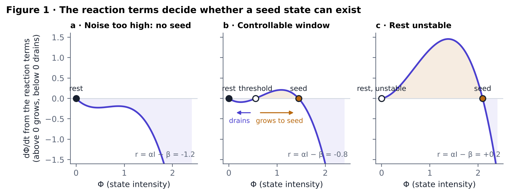
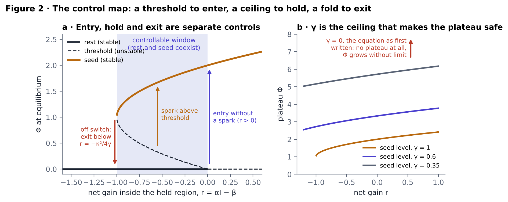
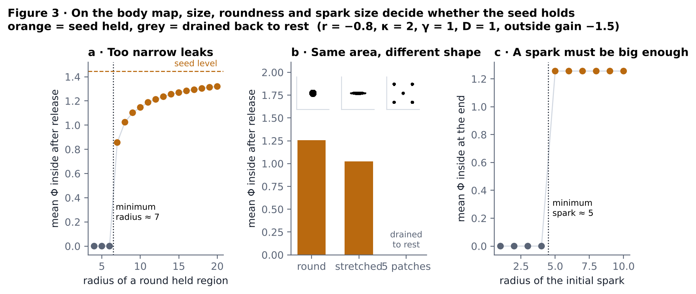
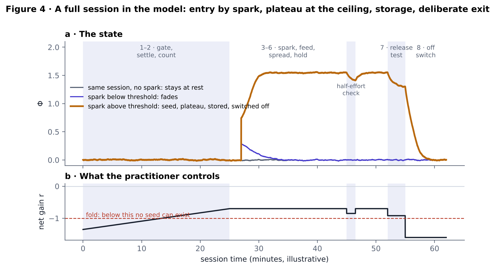
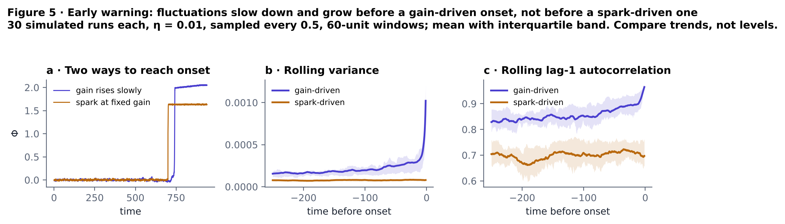

# Abstract

Contemplative traditions describe absorbed states that, once entered, sustain themselves with little effort, and a few trained practitioners show physiological control well beyond what untrained people can produce. What is missing is a way to approach such limits *controllably*: knowing when a state can start, what caps it, and how to end it on demand. This paper proposes Φ, a minimal reaction–diffusion model of a self-sustaining absorbed state on a two-dimensional body map:

∂Φ/∂t = (αI − β)Φ + κΦ² − γΦ³ + D∇²Φ + s + η.

Φ is a latent variable, the intensity of the absorbed state at each point of the map, not a physical field. Each term is matched to something a practitioner trains or measures: coupling to body signals (α), the number of regions bound together (I), mental noise (β), a pleasure–attention feedback loop (κ), a ceiling (γ), spread (D), a generated spark (s) and spontaneous fluctuations (η). Analysis and simulation show a bounded window, −κ²/4γ < αI − β < 0, in which rest and the absorbed state coexist. Inside it, entry needs a spark above a threshold, γ caps the state at a plateau, and exit is a deliberate move of the gain below −κ²/4γ. The model makes seven testable predictions about region size and shape, spark size, persistence after release, and early-warning signals before onset; the last distinguishes gain-driven from spark-driven onset. An interactive simulator and a step-by-step single-case protocol, with heart-rate-variability measures, an active paced-breathing control, a comparison method and stop rules fixed in advance, are released with the model. Here "beyond human limits" is defined operationally: beyond the practitioner's own measured baseline and beyond the control condition.

**Keywords:** meditation; absorption; jhāna; interoception; heart-rate variability; bistability; hysteresis; reaction–diffusion; early-warning signals; single-case design

# 1. Introduction

Trained practitioners can do things with their bodies that untrained people cannot. In g-tummo meditation, practitioners raised core body temperature during forceful-breathing practice (Kozhevnikov et al., 2013). After a training programme combining breathing, cold exposure and meditation, volunteers voluntarily activated their sympathetic nervous system and dampened their inflammatory response to endotoxin (Kox et al., 2014). These results show that some human limits are softer than they look. They also show the problem: methods that push physiology hard, often with forced breathing, carry real risk, and they rarely say in advance when the effect will start, how far it will go, or how to stop it.

Concentration traditions describe a different route. In the jhāna method taught by Brasington (2015), the practitioner builds steady concentration, turns attention to a mildly pleasant sensation, and stops adding effort, so that attention and pleasure feed each other until a whole-body absorbed state carries itself. A case study recorded brain activity in one adept moving in and out of such states (Hagerty et al., 2013), and recent work links phenomenology and brain connectivity in jhāna to changes in nonlinear processing (Potash et al., 2025). Neurofeedback studies associate "effortless" awareness with reduced activity in the posterior cingulate cortex (Garrison et al., 2013; van Lutterveld et al., 2017). The evidence is thin, mostly single cases and practitioner report, and no controlled trials exist.

This paper offers three things. First, a minimal equation that turns the traditional description into a dynamical model with explicit thresholds, a ceiling and an exit. Second, an analysis of that model, with simulations anyone can rerun and an interactive simulator. Third, a protocol that maps each term to a step of practice and to a measurement, so the model can be tested in a single practitioner with controls fixed in advance.

The claim of the title is about *control*, not about any particular power. A method is controllable here if three things are known before a session starts: when the state can begin, what caps it, and how to end it. Pushing "beyond human limits" means improving measured outcomes beyond the practitioner's own pre-training baseline and beyond an active control condition, while staying inside those three boundaries.

# 2. The model

## 2.1 Equation

Let Φ(x, t) ≥ 0 be the intensity of the absorbed state at location x on a two-dimensional body map, at time t. Inside a held region Ω (the part of the body the practitioner holds in attention), the dynamics are

∂Φ/∂t = (αI − β)Φ + κΦ² − γΦ³ + D∇²Φ + s + η ξ(x, t),

where ξ is unit white noise. Outside Ω the linear gain is a constant r_out < 0, so unattended regions decay, and s = 0. The map's edges are zero-flux. All quantities are dimensionless. Throughout, r = αI − β denotes the net gain inside Ω.

Φ is a latent psychological variable. The model is a description of how a trained attentional state could behave, of the same kind as neural-field models of bistable activity (Amari, 1977) and the cubic reaction model of Schlögl (1972). It makes no claim that Φ is a physical field.

## 2.2 What each term means

| Term | Meaning | How it is trained | How it is measured |
|---|---|---|---|
| α, coupling | How strongly attention engages body signals | Heartbeat counting; receiving and sending at body centres | Heartbeat-counting accuracy (Schandry, 1981; Garfinkel et al., 2015); voluntary heart-rate change with breath held constant |
| I, richness | How many body regions are bound into one state | Holding head, chest and belly as one sphere | Collapses per minute; area and roundness of a post-session body map |
| β, noise | Mind-wandering and arousal noise | Breath counting | Breath-counting errors (Levinson et al., 2014); a 2-minute RMSSD "gate" before each session |
| κ, self-feedback | The pleasure–attention loop: attention strengthens a pleasant sensation, the sensation holds attention | Attending only to pleasantness, with no added effort | Ratings through half-effort checks; persistence in the release test |
| γ, ceiling | Saturation that caps the state at a plateau | Recognising the plateau and not pushing past it | Minute-by-minute ratings; time to plateau |
| D, spread | How the state diffuses across the map | Not trained directly; width and roundness are trained against it | Inferred from map shape |
| s, steady drive | A generated spark: goodwill or recalled joy | The generated-spark route | Rating after the generation phase |
| η, fluctuations | Spontaneous sensations: a noticed spark | The noticing route | — |

# 3. Analysis

## 3.1 Three regimes of the reaction terms

Without spread, drive or noise, the reaction terms f(Φ) = rΦ + κΦ² − γΦ³ have fixed points at Φ = 0 and Φ± = [κ ± √(κ² + 4γr)] / 2γ. Three regimes follow (Figure 1):

- **r < −κ²/4γ (noise too high).** Only rest exists. No seed state is possible, however strong the spark.
- **−κ²/4γ < r < 0 (the controllable window).** Rest (Φ = 0) and the seed state (Φ₊) are both stable, separated by an unstable threshold (Φ₋). A spark above Φ₋ grows to Φ₊; a spark below it drains.
- **r > 0 (rest unstable).** Any fluctuation grows to the seed state.

With the default values used throughout (α = 0.7, I = 1, β = 1.5, κ = 2, γ = 1, D = 1, r_out = −1.5), r = −0.8: rest is at 0, the threshold at Φ₋ = 0.553 and the seed level at Φ₊ = 1.447.

## 3.2 The control map

Plotting the fixed points against r gives a fold (saddle-node) bifurcation at r_f = −κ²/4γ (Strogatz, 2015), which is −1 for the default values (Figure 2a). The result is hysteresis, which separates the three things a practitioner must control:

1. **Entry.** In the window, the state starts only from a spark above Φ₋, or without a spark once r crosses 0.
2. **Hold.** Once started, the state stays at Φ₊ even if r falls, as long as it stays above r_f. This is what the protocol's half-effort checks and release test probe: if the state persists when effort is withdrawn, κ is carrying it.
3. **Exit.** Lowering r below r_f removes the seed state, and Φ returns to rest. In practice this is the off switch: eyes open, movement and speech raise β.

The ceiling γ sets the plateau (Figure 2b): Φ₊ falls as γ rises. Without it (γ = 0, the form in which the equation was first written), the reaction terms are rΦ + κΦ²: there is a threshold, −r/κ, but no stored level, and above threshold Φ grows without limit. The ceiling is what makes the plateau safe and the method controllable.

## 3.3 Size, shape and spark on the body map

Spread leaks the state across the edge of Ω into regions where r_out < 0, so the held region has to be large enough. With the default values a round region holds the seed only from a radius of about 7 grid units; below that it drains (Figure 3a). At equal area, a round region held the state (mean Φ inside 1.26), a stretched ellipse held it more weakly (1.02), and five scattered patches each drained (Figure 3b). A spark, too, must exceed a critical size: in a round region of radius 14, sparks of radius 4 or less faded and sparks of radius 5 or more filled the region (Figure 3c).

Whether the state stays inside Ω or spreads across the map depends on the outside gain. In the bistable case, a front between rest and the seed state advances into rest when the seed is the more stable state, which for these reaction terms means r_out > −2κ²/9γ (−0.89 for the defaults). Below that, the state stays where it is held.

## 3.4 Starting without a deliberate spark

A steady drive s inside Ω raises the rest level and lowers the threshold. For the defaults, a drive of 0.05 let a radius-3 spark catch that would otherwise fade, and a drive above about 0.091 removed the rest state altogether, so the seed formed with no spark. Fluctuations η alone cannot start the state in the window, but where r > 0 they are the spark: without them nothing grows. These correspond to the protocol's two ways in: generating a pleasant feeling (s) and noticing one that is already present (η).

## 3.5 A session in the model

Figure 4 runs a full session through the single-region (mean-field) form of the model. During settling, r rises from −1.35 to −0.70 as noise falls. A spark of 0.75 at minute 27 catches and the state plateaus at 1.55. A half-effort check briefly lowers r to −0.85, and the state holds. In the release test r falls to −0.92, still above the fold, and the state keeps 84% of its plateau. The off switch takes r to −1.6, below the fold, and Φ returns to 0.004. The same session with no spark, or with a spark of 0.3 below the threshold, stays at rest.

## 3.6 Early-warning signals: a discriminating prediction

Many systems approaching a tipping point recover more slowly from small disturbances, so their fluctuations grow in variance and in lag-1 autocorrelation before the transition (Scheffer et al., 2009; Dakos et al., 2012). In the model, the recovery rate of rest is |r|, which goes to zero as r approaches 0. So if onset comes from a slow rise in gain, warning signals should appear before it. If onset comes from a discrete spark at a fixed gain, they should not.

In 30 simulated runs of each kind (η = 0.01, signals sampled every 0.5 time units, 60-unit windows, 250 units before onset), variance rose before gain-driven onset in 79% of runs (median Kendall τ = 0.33) and lag-1 autocorrelation in 72% (median τ = 0.36). Before spark-driven onset the trends were near zero (median τ = 0.07 and 0.10; 60% and 67% positive, close to chance). Figure 5 shows the averages. The separation is real but moderate in single runs, so the empirical test needs many onsets.

This test has not, to the author's knowledge, been applied to meditative absorption. In practice the signal is a beat-to-beat heart series recorded throughout each session, so the practitioner never has to report during the build-up.

# 4. Predictions

Each prediction is stated so that a result can contradict it.

- **H1 (shape).** At equal attended area, sessions holding one round region reach the seed criteria more often than sessions holding a single point or scattered points.
- **H2 (spark size).** Onset follows sparks that are larger, or longer, than those that fade, as rated immediately afterwards.
- **H3 (gate).** Onset is rarer on days with a higher pre-session noise rating and lower gate RMSSD, with a ceiling above which onset does not occur.
- **H4 (storage).** In the 3-minute release test, the state's rating and the heart-rate-variability marker stay shifted for longer after seed sessions than after time-matched paced-breathing control sessions.
- **H5 (hysteresis).** Within a session, the state persists through a half-effort check that, from rest, would not have started it.
- **H6 (ceiling).** Ratings stop rising at a plateau; sessions that push past it show more agitation and headache and no gain in persistence.
- **H7 (early warning).** Variance and lag-1 autocorrelation of beat-to-beat intervals rise in the minutes before marked onsets more than in matched stretches without onset, and more for gradual onsets than for onsets following an abrupt spark.

# 5. Protocol

The full protocol, written step by step, is released with this paper (protocol/protocol.md). In outline:

- **Design.** A preregistered single-case design in which seed sessions alternate with active control sessions. The control is paced breathing at 6 breaths per minute, which on its own produces a large change in heart-rate variability (Lehrer & Gevirtz, 2014), so the seed must beat a strong alternative. A comparison method, a conviction-based route, runs in alternating blocks so the data can decide which route builds the state faster.
- **Session.** Gate (3 min), settle and count (15–25 min), find the spark (2–5 min), feed the loop (5–15 min), spread it (about 5 min), hold and check (5–10 min), release test (3 min), off switch and log (3 min).
- **Seed criteria, fixed in advance.** A marked onset; a plateau rating of 7/10 or more with a body map covering at least half the head and torso; a rating of 6 or more through two half-effort checks; and, at the end of the release test, a rating at least half the plateau with RMSSD still above its pre-session value.
- **Measures.** RMSSD from a chest strap (Shaffer & Ginsberg, 2017) as the primary marker; 0–10 ratings spoken aloud at fixed times; body maps; breath-counting errors; heartbeat-counting accuracy.
- **Training.** Each variable is trained alone in leveled daily drills before full sessions combine them; a level is passed on three separate days.
- **Programme.** Two weeks of baseline, then three blocks separated by gates: Block A sets the practitioner's ceiling, Block B compares routes and region shapes, Block C tests the generated-spark route and the early-warning prediction.

# 6. What "beyond human limits" means here

The phrase is used operationally. A limit is the practitioner's own measured ceiling before training, on outcomes that can be checked by an instrument, and pushing beyond it means exceeding both that baseline and the active control:

- voluntary heart-rate reduction with the breath held to a metronome at the resting rate, so breathing cannot carry the change;
- minutes of absorbed attention sustained without effort, as measured by half-effort checks;
- persistence of the state after all driving stops, in the release test;
- heartbeat-counting accuracy.

Whether training on this model takes a person past the limits of untrained people in general is a later question. It needs many practitioners and is not claimed here.

# 7. Limitations

The model is minimal. Its parameters are not yet estimated from data, and several combinations of them produce similar behaviour, so a fit to ratings alone would not identify them. The body map is an abstraction; the shape effects are predictions about attention, not about anatomy. Ratings are vulnerable to expectation, which is why the protocol puts weight on the strap, on the active control and on predictions fixed in advance. Single-case results do not generalise without replication. Early-warning signals are noisy, can appear without a transition and can be absent before one; the simulations show only moderate separation in single runs. Finally, the simulations show what the equation does, not that any real state follows it.

# 8. Safety

Meditation is not risk-free. A systematic review found adverse events in 8.3% of participants across 83 studies, most often anxiety and depression (Farias et al., 2020), and intensive practice can bring unusual experiences that some find distressing (Lindahl et al., 2017). The protocol uses attention only: no forced breathing and no breath-holding at any step. It ends every session with a deliberate off switch, schedules sessions after sleep because sleep loss damages vigilance most of all (Lim & Dinges, 2010), and lists stop rules written down before the first session. People with a personal or family history of psychosis or bipolar disorder should practise only with clinical oversight. The practice is training, not treatment.

# 9. Availability

The model code (Python), the figure scripts, the interactive simulator and the protocol are released at the project repository under the MIT licence for code and CC BY 4.0 for text and figures. Every figure and number in this paper is regenerated by `python model/make_figures.py`.

**Competing interests:** none. **Funding:** none.

**Use of AI tools:** model code, simulations, figures and drafting were carried out with the assistance of an AI system (Claude, Anthropic). The author directed the work and is responsible for its content.

# References

Amari, S. (1977). Dynamics of pattern formation in lateral-inhibition type neural fields. *Biological Cybernetics*, 27, 77–87.

Brasington, L. (2015). *Right Concentration: A Practical Guide to the Jhānas*. Shambhala.

Dakos, V., Carpenter, S. R., Brock, W. A., et al. (2012). Methods for detecting early warnings of critical transitions in time series illustrated using simulated ecological data. *PLoS ONE*, 7(7), e41010.

Farias, M., Maraldi, E., Wallenkampf, K. C., & Lucchetti, G. (2020). Adverse events in meditation practices and meditation-based therapies: a systematic review. *Acta Psychiatrica Scandinavica*, 142(5), 374–393. https://doi.org/10.1111/acps.13225

Garfinkel, S. N., Seth, A. K., Barrett, A. B., Suzuki, K., & Critchley, H. D. (2015). Knowing your own heart: distinguishing interoceptive accuracy from interoceptive awareness. *Biological Psychology*, 104, 65–74.

Garrison, K. A., Santoyo, J. F., Davis, J. H., Thornhill, T. A., Kerr, C. E., & Brewer, J. A. (2013). Effortless awareness: using real time neurofeedback to investigate correlates of posterior cingulate cortex activity in meditators' self-report. *Frontiers in Human Neuroscience*, 7, 440.

Hagerty, M. R., Isaacs, J., Brasington, L., Shupe, L., Fetz, E. E., & Cramer, S. C. (2013). Case study of ecstatic meditation: fMRI and EEG evidence of self-stimulating a reward system. *Neural Plasticity*, 2013, 653572. PMID 23738149.

Kox, M., van Eijk, L. T., Zwaag, J., et al. (2014). Voluntary activation of the sympathetic nervous system and attenuation of the innate immune response in humans. *Proceedings of the National Academy of Sciences*, 111(20), 7379–7384.

Kozhevnikov, M., Elliott, J., Shephard, J., & Gramann, K. (2013). Neurocognitive and somatic components of temperature increases during g-tummo meditation: legend and reality. *PLoS ONE*, 8(3), e58244.

Lehrer, P. M., & Gevirtz, R. (2014). Heart rate variability biofeedback: how and why does it work? *Frontiers in Psychology*, 5, 756.

Levinson, D. B., Stoll, E. L., Kindy, S. D., Merry, H. L., & Davidson, R. J. (2014). A mind you can count on: validating breath counting as a behavioral measure of mindfulness. *Frontiers in Psychology*, 5, 1202.

Lim, J., & Dinges, D. F. (2010). A meta-analysis of the impact of short-term sleep deprivation on cognitive variables. *Psychological Bulletin*, 136(3), 375–389.

Lindahl, J. R., Fisher, N. E., Cooper, D. J., Rosen, R. K., & Britton, W. B. (2017). The varieties of contemplative experience: a mixed-methods study of meditation-related challenges in Western Buddhists. *PLoS ONE*, 12(5), e0176239.

Potash, R. M., van Mil, S. D., Estarellas, M., Canales-Johnson, A., & Sacchet, M. D. (2025). Integrated phenomenology and brain connectivity demonstrate changes in nonlinear processing in jhana advanced meditation. *Journal of Cognitive Neuroscience*, 37(11), 2260–2283. https://doi.org/10.1162/JOCN.a.50

Schandry, R. (1981). Heart beat perception and emotional experience. *Psychophysiology*, 18(4), 483–488.

Scheffer, M., Bascompte, J., Brock, W. A., et al. (2009). Early-warning signals for critical transitions. *Nature*, 461, 53–59.

Schlögl, F. (1972). Chemical reaction models for non-equilibrium phase transitions. *Zeitschrift für Physik*, 253, 147–161.

Shaffer, F., & Ginsberg, J. P. (2017). An overview of heart rate variability metrics and norms. *Frontiers in Public Health*, 5, 258.

Strogatz, S. H. (2015). *Nonlinear Dynamics and Chaos* (2nd ed.). Westview Press.

van Lutterveld, R., Houlihan, S. D., Pal, P., et al. (2017). Source-space EEG neurofeedback links subjective experience with brain activity during effortless awareness meditation. *NeuroImage*, 151, 117–127. https://doi.org/10.1016/j.neuroimage.2016.02.047
